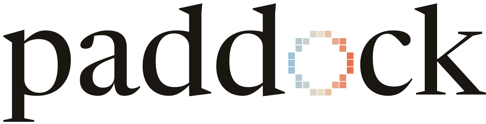
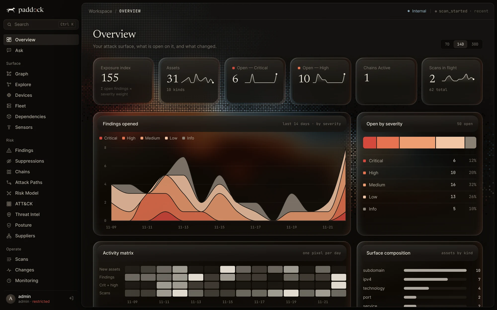
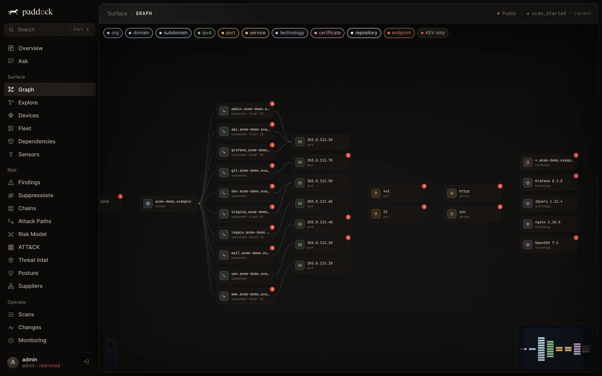
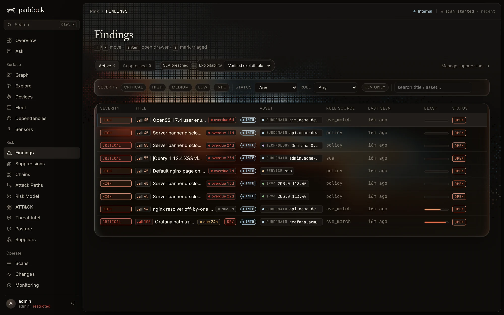
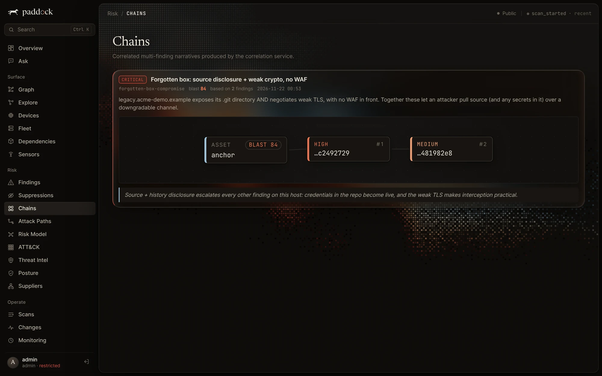
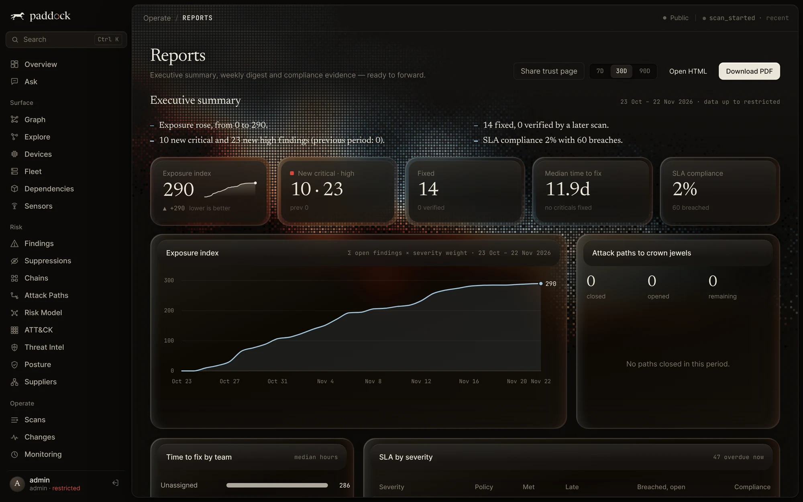
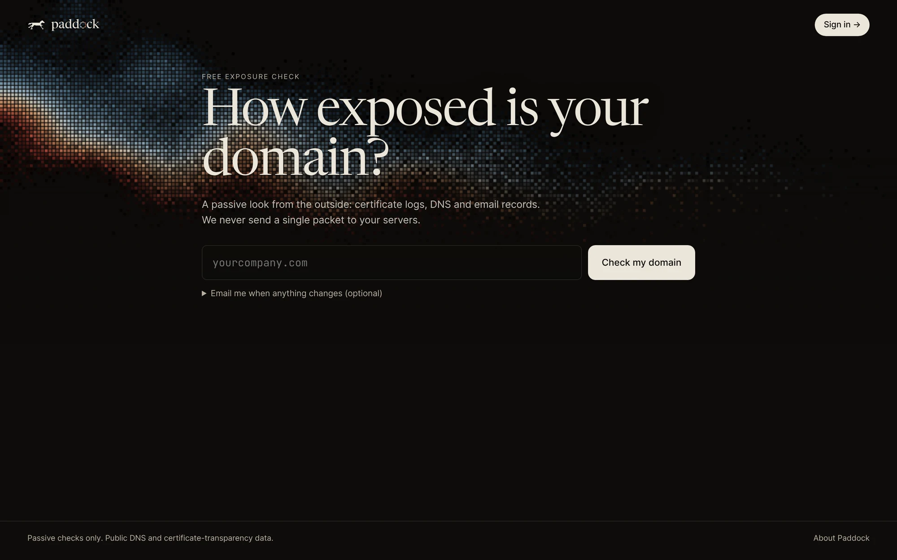
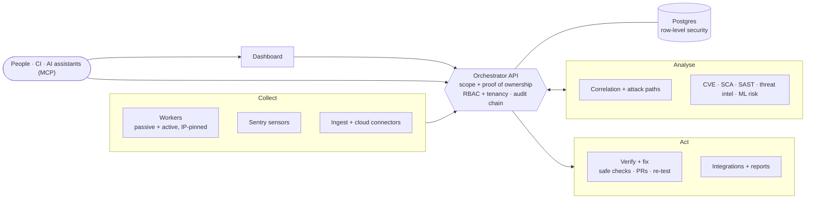

<h1 align="center">
  <picture>
    <source media="(prefers-color-scheme: dark)" srcset="docs/assets/paddock-wordmark.svg">
    
  </picture>
</h1>

<p align="center">
  <b>Find it. Prove it. Fix it. Prove it's fixed.</b><br>
  Open-source, self-hosted defensive security: your attack surface, the paths an attacker would take,<br>
  and verified proof that each door is closed.
</p>

<p align="center">
  <a href="https://github.com/brandongraff-dev/cybersec/actions/workflows/ci.yml"></a>
  <a href="https://github.com/brandongraff-dev/cybersec/actions/workflows/integration.yml"></a>
  <a href="https://github.com/brandongraff-dev/cybersec/actions/workflows/install.yml"></a>
  <a href="LICENSE"></a>
  
</p>

<p align="center">
  <a href="#quickstart">Quickstart</a> ·
  <a href="#what-you-get">Features</a> ·
  <a href="#how-it-works">Architecture</a> ·
  <a href="#integrations">Integrations</a> ·
  <a href="docs/">Docs</a> ·
  <a href="SECURITY.md">Security</a>
</p>

<p align="center">
  <a href="docs/media/paddock-demo.mp4">
    
  </a>
  <br><sub>20-second tour on the built-in demo data · <a href="docs/media/paddock-demo.mp4">full-quality MP4</a></sub>
</p>

---

## Why Paddock

Most security tools stop at a list of *possible* problems, and every team
already has more of those than it can fix. Paddock closes the loop:

| | |
|---|---|
| **1. Find** | Discover what you actually expose: domains, hosts, services, cloud assets, code, dependencies and the devices on your network. |
| **2. Prove it's real** | A safe, non-destructive check confirms the issue is exploitable, only against systems you've **proven you own**. Noise drops out. |
| **3. Fix** | Get the fix as a pull request, config change or dependency bump, behind a human approval gate. |
| **4. Prove it's fixed** | When the ticket closes or the PR merges, Paddock re-tests. If the fix didn't hold, the finding reopens. |

Every result lands as evidence: executive reports, compliance packs
(PCI DSS 4.0, NIST CSF 2.0, ISO 27001, IEC 62443, EU CRA) and shareable trust
pages for insurers and customers.

**It is a defender's tool.** No exploit framework, no credential attacks, no
evasion. Every outbound request is scope-checked, pinned to vetted IPs and
audit-logged ([hard rules](#safety-by-design)).

## Screenshots

<table>
  <tr>
    <td width="50%"><br><b>Overview</b>: exposure index, findings over time, what changed</td>
    <td width="50%"><br><b>Attack graph</b>: your surface as a graph, blast radius per node</td>
  </tr>
  <tr>
    <td><br><b>Verified findings</b>: SLA clocks, KEV, priority you can explain</td>
    <td><br><b>Chains</b>: three medium findings that are one critical story</td>
  </tr>
  <tr>
    <td><br><b>Reports</b>: executive summary, MTTR, SLA, PDF export</td>
    <td><br><b>Free exposure check</b>: passive, no packets to the target</td>
  </tr>
</table>

## Quickstart

**Run the platform** (Docker + Compose, about 5 minutes):

```bash
git clone https://github.com/brandongraff-dev/cybersec paddock && cd paddock
make quickstart        # builds the stack, seeds a demo surface, prints the URL + login
```

Open **http://localhost:3000** and start on the **Graph** page. Prefer something
lighter? `make lite` runs a 5-service single node (~150 MB RAM) with the same
hardening. Production: [Helm chart and operations guide](docs/OPERATIONS.md).

**Scan your own repo, no server needed** (the open-source `paddock` CLI):

```bash
pipx install "git+https://github.com/brandongraff-dev/cybersec#subdirectory=cli"
paddock scan .         # vulnerable dependencies, secrets, code and config issues
paddock fix .          # deterministic fixes as a diff, or --pr to open a pull request
```

**Connect anything** in a minute: point any scanner (SARIF, CycloneDX, SPDX,
Trivy, Grype, Semgrep, Nuclei, ZAP, CSV) at `POST /v1/ingest`, or let Claude,
Cursor or any MCP client query Paddock through the
[MCP server](mcp/). See [Connect anything](docs/CONNECT.md).

## What you get

<table>
<tr><td valign="top" width="50%">

**Discover**
- Passive recon: certificate transparency, DNS, GitHub code search, Shodan InternetDB, ASN expansion
- Polite active probing of authorised scope: HTTP, TLS, ports, safe Nuclei tags, screenshots
- Cloud inventory from AWS, GCP and Azure (read-only)
- **Sentry**: a passive network sensor (a Raspberry Pi works) that identifies every IoT/OT device on a mirror port

**Prioritise**
- Attack paths from internet-facing footholds to crown jewels, with blast radius
- Chains: correlated multi-finding stories instead of disconnected rows
- CVE matching against NVD, EPSS and CISA KEV; SCA, SBOM and SAST
- A priority score that always explains itself ("KEV-listed · internet-facing · 2 hops from payments")

</td><td valign="top" width="50%">

**Prove and fix**
- Verified exploitability with 11 safe checks, pinned to scope-vetted IPs
- Fix generation behind an approval gate; automatic re-test after the fix
- Finding lifecycle: dedupe, suppressions with reasons and expiry, SLA clocks

**Report and govern**
- Executive reports (HTML/PDF), weekly digests, compliance evidence packs
- Trust pages for insurers; passive supplier monitoring
- Multi-tenant with Postgres row-level security across every service; MSP console
- SSO (OIDC + SAML), SCIM 2.0, RBAC + ABAC, and a hash-chained, anchored audit log

</td></tr>
</table>

## Integrations

| Category | Connectors |
|---|---|
| Chat and alerting | Slack · Microsoft Teams · PagerDuty · Email · signed Webhooks |
| Ticketing (two-way) | Jira · ServiceNow · Linear |
| SIEM (OCSF) | Splunk · Microsoft Sentinel · Elastic · Google SecOps · Syslog/CEF |
| Cloud and context | AWS · GCP · Azure · CrowdStrike · Microsoft Defender · ServiceNow CMDB |
| Network actions | UniFi · Meraki (quarantine only after a human approves, with a reason) |
| Developer | REST API (`/v1`, OpenAPI) · Python + TypeScript SDKs · Terraform provider · GitHub Action · CI templates for GitLab, Bitbucket, Azure DevOps, CircleCI, Jenkins · MCP server |
| Standards | SARIF · CycloneDX · SPDX · VEX · OCSF · STIX/TAXII 2.1 |

All 21 connectors share one framework: encrypted secrets, retries with backoff,
a dead-letter queue, outbound connections pinned to validated IPs, and one
Integrations page with health for each ([docs](docs/INTEGRATIONS.md)).

## How it works



- **One authoritative API.** The orchestrator owns the database, scope and
  authorisation; every other component is a small, replaceable service that
  talks to it.
- **Nothing touches a target without permission.** Scope is checked at
  dispatch and again on every request and redirect. Active checks require proof
  of ownership (DNS TXT, HTTPS file or attestation), and connections are pinned
  to the IPs that were vetted.
- **Every tenant is isolated in the database.** Each service connects as its
  own least-privilege role under Postgres row-level security. Tests sweep every
  table and every API route across tenants.

Deep dive: [architecture](docs/ARCHITECTURE.md) ·
[tenancy](docs/trust/TENANCY.md) · [operations](docs/OPERATIONS.md) ·
[API](docs/API.md).

## Safety by design

These are enforced in code, not just documented:

- **No exploitation.** Safe checks use GET, HEAD, TLS handshakes and TCP connects only, with size and time caps. No payloads, no PoCs.
- **No credential attacks.** Default-credential risk is detected by fingerprinting, never by submitting passwords.
- **No evasion.** No stealth scans, WAF bypass, decoys or spoofing; the scanner names itself.
- **No out-of-scope anything.** Out-of-scope is a hard failure, and every decision is written to the audit log.

> **Authorised use only.** Point Paddock only at assets you own or are
> explicitly, documentedly authorised to assess. Full statement:
> [SECURITY.md §12](SECURITY.md).

## Project status

Paddock is young and moving fast. We'd rather tell you where the edges are.

**Solid**
- 3,100+ automated tests across every service, the dashboard, SDKs, CLI and MCP server, plus 207 detection-quality cases gated in CI.
- The orchestrator suite runs twice in CI, the second time as the non-superuser row-level-security role, which proves tenant isolation.
- Clean-machine installs of the full and lite stacks and an end-to-end integration harness run in CI whenever the stack changes.
- Adversarial reviews of the public surface, tenancy and outbound safety, with every finding fixed and pinned as a regression test.

**Still to do** ([full list](docs/READINESS.md))
- Connectors are tested against protocol-accurate fakes, not yet against live SaaS tenants.
- The ML risk model is cold-start until real history accumulates.
- One shared service key between internal services (route-limited in strict mode). Per-service keys are next.
- No SOC 2 report or third-party pen test yet.

## Editions and license

Paddock is **[AGPL-3.0](LICENSE)**. Self-hosting is free and stays free: clone
it, run it, modify it. Paid editions add hosting, enterprise features and
support ([editions](docs/EDITIONS.md)). Contributions are accepted under a
[CLA](CLA.md) so the project can also offer a commercial license.

## Contributing and community

- **Contributing:** [CONTRIBUTING.md](CONTRIBUTING.md) covers dev setup, the test suites and the integration harness.
- **Security issues:** please report privately; see [SECURITY.md](SECURITY.md).
- **Trust pack:** [whitepaper, SOC 2 mapping, DPA and policies](docs/trust/), and [how to verify a signed release](docs/trust/VERIFY.md).
- **Docs:** everything else is in [`docs/`](docs/), including the [product vision](docs/VISION.md) and the [Sentry kit guide](docs/SENTRY_KIT.md).

Issues and PRs welcome. If something breaks on your first `make quickstart`,
that's a bug we want to hear about.
