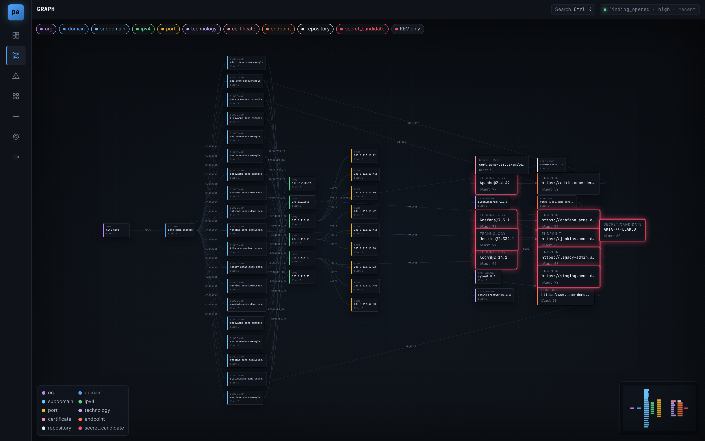
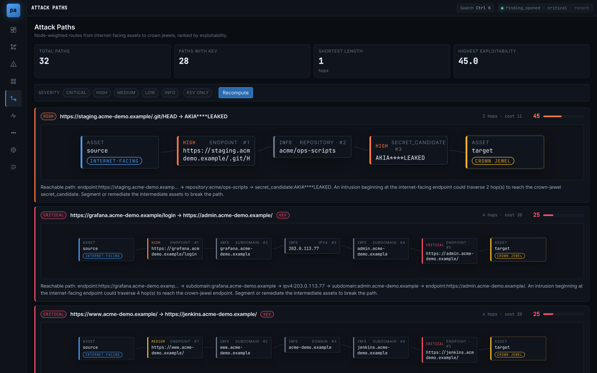
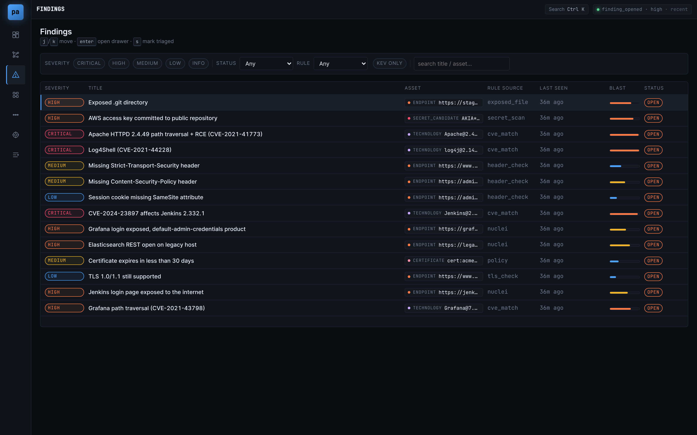
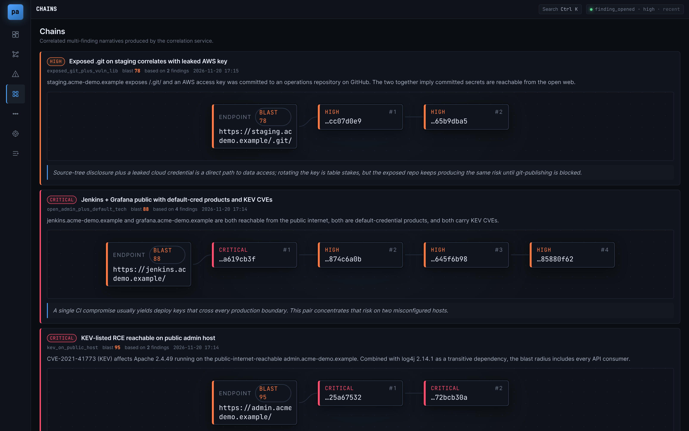
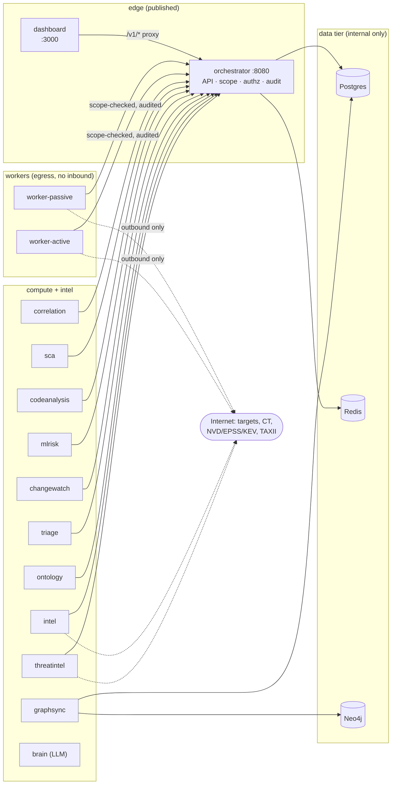

# Paddock

**Map the real attack paths from your internet-facing surface to your crown jewels — plus SCA, threat-intel, and an adaptive risk model, in one self-hosted platform.**

[](https://github.com/brandongraff-dev/cybersec/actions/workflows/ci.yml)
[](https://github.com/brandongraff-dev/cybersec/actions/workflows/integration.yml)
[](LICENSE)
[](#community)

Paddock is a **defensive** Attack Surface Management + threat-intelligence
platform for teams defending their own infrastructure. Point it at assets you're
authorized to assess; it discovers them from passive sources, politely probes the
ones you've allowed, correlates what it finds against public vulnerability and
threat feeds, and surfaces the result as a graph you can actually navigate.

**It is a defender's tool.** No exploit framework, no credential attacks, no
evasion. Every outbound request is scope-checked and audit-logged. See the
[hard rules](#hard-rules--what-this-will-not-do).

> ⚠️ **Authorized use only.** Point this only at assets you own or are
> explicitly, documentedly authorized to assess. [Jump to the notice.](#authorized-use-only)

---

## What it does

**The superpower: attack paths.** Most ASM tools hand you a list. Paddock
builds the *graph* — assets, the edges between them, and the findings on each —
and then walks it to show you the **paths an attacker would actually take**, from
an internet-facing foothold to something that matters, with the hop-by-hop
narrative and a blast-radius score. The chain detector folds noise like
`exposed .git + outdated library + no WAF` into a single high-severity story
instead of three disconnected rows.

Around that core it also gives you:

- **Discover (passive):** CT logs (crt.sh + live CertStream), DNS enumeration,
  GitHub code search, Shodan InternetDB, Wayback, ASN range expansion.
- **Probe (active, authorized only):** HTTP + security-header analysis,
  exposed-file detection, port scanning (naabu), TLS inspection/grading (tlsx),
  link crawling (katana), nuclei checks (safe tags only), Playwright screenshots.
- **Correlate:** CPE-based CVE↔asset matching against **NVD + EPSS + CISA KEV**,
  policies-as-code (hot-reloaded YAML), and blast-radius scoring across the graph.
- **Supply chain (SCA):** lockfile → SBOM → OSV matching, plus first-party SAST
  and dependency reachability (detection only).
- **Threat-intel:** STIX 2.1 / TAXII 2.1 IOC ingest, matched defensively against
  your own assets and findings.
- **Inside the network (Paddock Sentry):** a listen-only sensor on a mirror
  port identifies every IoT/OT device and flags devices that scan, cross
  segments, phone home from OT, or start behaving unlike their model
  ([guide](docs/SENTRY.md)).
- **Adaptive risk:** an ML risk ranker and anomaly detector (cold-start — see
  [Status](#status-honest)), surface-change tracking, owner routing + ticketing.
- **Governance built in:** auth (API keys + JWT), RBAC + ABAC classification
  filtering pushed into SQL, and a **tamper-evident, hash-chained audit log** you
  can verify.
- **An analyst UI:** dark, dense, keyboard-driven — live asset graph (react-flow),
  findings table, chain cards, attack paths, a day-by-day timeline, and a scope
  admin page with its own audit trail.

Under the hood it's ~15 small services around one authoritative FastAPI
orchestrator (plus Postgres / Redis / Neo4j). You don't have to care about that
to run it — but if you do, see [Architecture](#architecture).

## Quickstart (5 minutes)

**Requirements:** Docker + Docker Compose. That's it.

```bash
git clone https://github.com/brandongraff-dev/cybersec
cd cybersec

cp .env.example .env                 # dev defaults are fine as-is
docker compose up -d --build         # build + start the whole stack (dev profile)
make demo                            # seed a demo graph + print URLs & login

# open the dashboard:
open http://localhost:3000           # (or just visit it)
```

Or do all of it in one shot:

```bash
make quickstart                      # = cp .env + docker compose up + make demo
```

`make demo` seeds a representative demo surface (the fictional `acme-demo.example`),
so the dashboard has a real-looking graph, findings, and an attack chain the
moment you open it — **start on the Graph page** (`/graph`).

**Login.** The dev profile runs `AUTH_MODE=dev`: you're a synthetic admin, so
**no login is required** — a first-timer isn't blocked by auth. Because of that,
the dev profile publishes its ports on `127.0.0.1` only, and the orchestrator's
own default is `AUTH_MODE=enforce` (anything that forgets to set it fails
closed). (The hardened profile seeds an `admin` user whose password comes from
`ADMIN_BOOTSTRAP_PASSWORD` in `.env`; no known credential is ever shipped. See
[SECURITY.md §4](SECURITY.md).)

When you're done:

```bash
make down      # stop (keeps data)      |   make nuke   # stop + wipe volumes
make status    # health-check services  |   make help   # every target
```

## Screenshots

Images live in [`docs/screenshots/`](docs/screenshots/) (see that folder's README
for how they're captured against the demo graph). The hero is the **Graph** page:

| | |
|---|---|
|  |  |
| **Asset graph** — the live surface, high/critical nodes highlighted | **Attack paths** — foothold → crown jewel, hop by hop |
|  |  |
| **Findings** — keyboard-driven, KEV/EPSS aware | **Chains** — correlated multi-finding stories |

> The repo ships the capture instructions, not binary image files — generate the
> PNGs locally with `make quickstart` then Playwright (see
> [`docs/screenshots/README.md`](docs/screenshots/README.md)).

## Architecture

The orchestrator owns the database and the API; everything else is a small,
replaceable service that talks to it over HTTP. Postgres is the system of record,
Redis is an ephemeral queue, Neo4j is a derived graph projection.



Full service map, ports, networks, and the discover→probe→correlate→surface data
flow: **[`docs/ARCHITECTURE.md`](docs/ARCHITECTURE.md)**.

## Scan your own stuff

Nothing reaches outside the allowlist in the `scope_entries` table. The safe
default scope is loopback + `scanme.nmap.org` (nmap's official legal target):

```bash
make seed-scope      # loads the safe default scope
```

Add your own authorized targets (with an authorization note), then scan:

```bash
make scope-add KIND=subdomain_wildcard VALUE=yourdomain.example AUTH="who authorized this"
make scan KIND=full_recon TARGET=yourdomain.example
```

Scope kinds: `domain`, `subdomain_wildcard`, `ipv4_cidr`, `ipv6_cidr`, `asn`.
Every outbound request is checked against this list at dispatch **and** re-checked
per-request in the worker's egress wrapper, and every decision is written to
`scope_decisions`. An out-of-scope request is a hard failure, not a warning.

### Authorized use only

> **Paddock may be pointed only at assets you own or are explicitly,
> documentedly authorized to assess.** Using it to scan, probe, or otherwise
> interact with systems you are not authorized to test may be illegal and is
> outside the supported and intended use of this project. The system enforces the
> scope allowlist at three layers and audits every outbound request, but **you**
> are responsible for operating it lawfully and within the bounds of your
> authorization. Full statement: [SECURITY.md §12](SECURITY.md).

## Status (honest)

This is an **early, MVP-grade** platform. It's real and runnable, and we'd rather
tell you exactly where the edges are than oversell it. (Full threat model and
known gaps: [SECURITY.md §10](SECURITY.md).)

**What works**

- The core pipeline end-to-end: discover → probe → correlate → surface, driven by
  an integration harness (`make integration`) that asserts the cross-service
  contracts.
- A broad test suite (~900 test functions across the services and the dashboard),
  run per-service in CI (`.github/workflows/ci.yml`).
- Scope enforcement (3 layers), RBAC/ABAC, and the tamper-evident audit chain are
  implemented and tested. The scope normaliser is differential-fuzzed against
  WHATWG and RFC 3986 URL parsers (`hardening/stress_scope.py`: 10M hostile
  targets, 0 disagreements) and refuses targets that resolve to cloud metadata
  or to private ranges you haven't explicitly scoped.
- One real authorized run against `scanme.nmap.org` with a crude false-positive
  measurement (`make realrun`, see [`hardening/RUNBOOK.md`](hardening/RUNBOOK.md)).

**What doesn't / what to know**

- **Validation is synthetic + one live host.** Detectors are validated against
  synthetic fixtures and a single live reference host (`scanme.nmap.org`). The FP
  number is a regression tripwire over a tiny hand-labeled truth set — **not** a
  precision/recall guarantee. No broad real-world study has been done.
- **The ML risk model is cold-start.** No pretrained/persisted model; it bootstraps
  from whatever's in your DB and is effectively uncalibrated until real history
  accumulates. Treat early risk scores and anomaly flags as low-confidence.
- **Not verified on a clean box via full compose.** The stack has not been
  stood up end-to-end from scratch on a fresh machine as part of release QA. Expect
  to hit rough edges on first `up`; please file them.
- **Single-tenant in practice** (RLS tenancy covers the API only — see
  [docs/trust/TENANCY.md](docs/trust/TENANCY.md)), no FIPS/compliance accreditation,
  audit tamper-resistance only with `AUDIT_HMAC_KEY` + an anchor sink, and some containers resist full lock-down (notably the active
  worker, which needs `NET_RAW` for SYN scans). Details in SECURITY.md §10.

If you're evaluating this for serious use: run it in the hardened profile, read
SECURITY.md end to end, and treat the risk scores as a starting point, not truth.

## Hard rules — what this will *not* do

These are built into the services, not just the docs (evasion-flavoured flags are
refused at import/exec time, not merely ignored):

- **No auto-exploitation.** No payload delivery, no PoC execution. Findings
  describe impact; they never carry a working exploit.
- **No credential attacks.** No brute force, spray, or stuffing. Default-credential
  *risk* is detected by fingerprinting the product, never by submitting passwords.
- **No evasion.** No stealth/fragmented scans, no WAF-bypass, no decoys, no source
  spoofing. The scanner's User-Agent names itself.
- **No out-of-scope anything.** Scope is gated at two layers and a hard failure.
- **No dangerous nuclei tags.** `-exclude-tags intrusive,fuzz,dos` is enforced.

A PR that tries to add any of the above will be rejected on sight. This posture is
what makes the tool legal to run, safe against production you depend on, and
employable inside an org. See [SECURITY.md §6](SECURITY.md) for why.

## License

**[AGPL-3.0](LICENSE)** (`SPDX-License-Identifier: AGPL-3.0-only`).

Open-core rationale: self-hosting Paddock is and will stay **free** — clone
it, run it, modify it. The AGPL's network-use clause (§13) means anyone who offers
a *modified* version as a network service must publish their changes under the same
license. That keeps the self-hosted project healthy and in the open while
protecting the option of a future managed-cloud offering, without taking anything
away from people who run it themselves.

## Community

- **Security:** [SECURITY.md](SECURITY.md) — threat model, scope invariant, and
  how to report a vulnerability (privately, please).
- **Trust:** [`docs/trust/`](docs/trust/) — security whitepaper, SOC 2 mapping,
  DPA/subprocessor templates, retention/IR/vuln-management policies, and
  [how to verify a signed release](docs/trust/VERIFY.md).
- **Contributing:** [CONTRIBUTING.md](CONTRIBUTING.md) — dev setup, running the
  tests + integration harness, and the "tests never touch a live DB" rule.
- **Conduct:** [CODE_OF_CONDUCT.md](CODE_OF_CONDUCT.md).
- **Docs:** [`docs/`](docs/) — architecture, inter-service contracts, per-service
  notes, the [product vision](docs/VISION.md), the
  [cloud roadmap](docs/CLOUD_ROADMAP.md), [commercial readiness](docs/READINESS.md),
  and the [Sentry sensor guide](docs/SENTRY.md).
- **Chat:** Discord — *link coming at launch* (badge above is a placeholder).

Issues and PRs welcome. If you're here from r/netsec: the
[Status](#status-honest) section is the honest pitch — tell us where it breaks.
