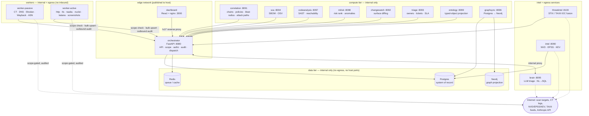

# Architecture

palantir-asm is a set of small services around one authoritative API. This doc
is the map: what each service does, how they're wired, and how a fact travels
from "we discovered a host" to "here's an attack path to your crown jewels".

For the inter-service request/response shapes see [`CONTRACTS.md`](CONTRACTS.md);
for the security model (trust boundaries, scope invariant, auth, audit) see
[`../SECURITY.md`](../SECURITY.md).

## The one idea

**The orchestrator owns the database.** No worker or compute service holds
Postgres credentials or writes the DB directly. They call the orchestrator's
HTTP API, which does all canonicalization, scope-checking, ABAC filtering, and
audit. Postgres is the system of record; Redis is an ephemeral queue/cache;
Neo4j is a *derived* graph projection. This keeps one choke point for authority
and means any individual service can be replaced without touching the others.

## Service map



<details>
<summary>ASCII fallback (same graph)</summary>

```
  Internet (targets, CT, NVD/EPSS/KEV, TAXII, Anthropic)
        ▲  (outbound only, scope-gated, audited)
        │
  ┌─────┴───────┐        ┌──────────────┐
  │ worker-      │        │ worker-       │
  │ passive      │        │ active        │
  └─────┬───────┘        └──────┬───────┘
        │  scope check / bulk upsert / outbound audit
        ▼                        ▼
  ┌───────────────────────── orchestrator (FastAPI :8080) ─────────────────────┐
  │   API · scope invariant · auth (RBAC/ABAC) · audit hash-chain · dispatch     │
  └───┬───────────────┬───────────────────────────────┬───────────────┬────────┘
      │ owns          │ proxies / is called by          │               │
      ▼               ▼                                 ▼               ▼
  Postgres        compute tier                      intel/egress     dashboard
  (record)   correlation, sca, codeanalysis,        intel (NVD/      (React/nginx :3000)
  Redis      mlrisk, changewatch, triage,           EPSS/KEV),       → /v1/* proxied
  (queue)    ontology, graphsync ──► Neo4j           threatintel,       to orchestrator
                                                      brain (LLM)
```

</details>

## Services at a glance

| Service | Port | Network(s) | Role |
|---|---|---|---|
| **orchestrator** | 8080 | edge, internal | The API and the only DB writer. Scope, auth, audit, dispatch, provenance. |
| **dashboard** | 3000 | edge, internal | React SPA served by nginx; reverse-proxies `/v1/*` to the orchestrator. |
| **worker-passive** | — | internal, egress | Passive discovery: CT logs, DNS, GitHub search, Shodan InternetDB, Wayback, ASN expansion. No inbound. |
| **worker-active** | — | internal, egress | Authorized polite probing: HTTP fingerprint, headers, exposed files, naabu ports, tlsx, katana, nuclei (safe tags), screenshots. |
| **intel** | 8090 | internal, egress | Ingests NVD / EPSS / CISA KEV; CPE-based CVE↔asset matching. |
| **correlation** | 8091 | internal | Chain detection, policies-as-code, blast-radius scoring, attack-path computation, ATT&CK mapping, finding fusion. |
| **changewatch** | 8092 | internal | Diffs the surface over time → `surface_changes`. |
| **triage** | 8093 | internal | Owner rules → tickets; SLA policies. |
| **sca** | 8094 | internal | Lockfile → SBOM → OSV vulnerability matching. |
| **brain** | 8095 | internal, egress | LLM finding-cluster triage and natural-language → validated read-only SQL. Degrades gracefully without an API key. |
| **graphsync** | 8096 | internal | Projects the Postgres asset graph into Neo4j. |
| **codeanalysis** | 8097 | internal | First-party SAST (Semgrep or bundled taint scanner) + dependency reachability. Detection only. |
| **mlrisk** | 8098 | internal | Risk ranking + anomaly detection. Cold-start (no pretrained model). |
| **ontology** | 8099 | internal | Projects assets/findings into typed ontology objects + links. |
| **threatintel** | 8100 | internal, egress | STIX 2.1 / TAXII 2.1 IOC ingest + defensive asset/finding matching. |
| **postgres** | — | internal | System of record. |
| **redis** | — | internal | Ephemeral queue / cache. |
| **neo4j** | — | internal | Derived graph projection (for graph queries). |

Ports are published to the host only under the **dev** profile
(`docker-compose.override.yml`). In the hardened profile only the orchestrator
(8080) and dashboard (3000) publish; everything else is reachable only on the
internal Docker networks. See `SECURITY.md` §9 for the network segmentation.

## Data flow: discover → probe → correlate → surface

1. **Scope.** An operator adds authorized targets to `scope_entries`
   (`POST /v1/scope`). Nothing leaves the system toward a host not on this list.
2. **Dispatch.** `POST /v1/scans` scope-checks the target *before* enqueuing a
   job on Redis. Attack-aid scan kinds are refused up front with a `400`.
3. **Discover (passive).** `worker-passive` pulls a job, re-checks scope against
   the authoritative `/v1/scope/check`, gathers assets from passive sources, and
   bulk-upserts them (`POST /v1/assets/bulk`) along with the edges between them.
4. **Probe (active, authorized).** `worker-active` politely probes authorized
   assets (per-host concurrency caps, inter-request delay, 429 backoff). Every
   outbound request is re-checked per-request (including redirects) and audited
   to `outbound_log`; findings land via `POST /v1/findings/bulk`.
5. **Enrich.** `intel` matches findings/assets against NVD/EPSS/KEV; `sca` and
   `codeanalysis` add dependency and code findings; `threatintel` matches IOCs.
6. **Correlate.** `correlation` turns individual findings into **chains**
   (e.g. `exposed .git + outdated library + no WAF` → one high-severity chain
   with an impact narrative), scores **blast radius** across the graph, and
   computes **attack paths** from internet-facing assets to high-value ones.
7. **Project.** `graphsync` mirrors the graph into Neo4j; `ontology` projects
   typed objects; `mlrisk` ranks risk and flags anomalies; `changewatch` records
   what changed; `triage` routes to owners and opens tickets.
8. **Surface.** The `dashboard` reads it all through the orchestrator: the live
   asset graph, findings table, chain cards, attack paths, a day-by-day
   timeline, and a scope admin page with its own audit trail.

Every mutating or sensitive request along the way is written to the
tamper-evident `audit_log` hash chain, and every produced fact can carry a
`provenance` row (which service produced it, how, with what evidence).

## Where the authority lives

- **Scope** — enforced at three layers (dispatch gate, worker egress wrapper,
  output filter), single decision point `POST /v1/scope/check`. (SECURITY.md §3)
- **Auth** — API keys + short-lived JWTs; RBAC roles + ABAC classification
  filtering pushed into SQL so over-classified rows never leave the DB.
  (SECURITY.md §4–§5)
- **Audit** — append-only, hash-chained, verifiable via `GET /v1/audit/verify`.
  (SECURITY.md §7)
- **Schema** — `schema/*.sql` is the source of truth; enumerations mirrored in
  code are kept in lockstep by tests (e.g. `test_rule_source_sync.py`).

## Development

Each service is its own Python package (`pyproject.toml`) with its own `tests/`.
See [`../CONTRIBUTING.md`](../CONTRIBUTING.md) for setup, how to run each suite,
the integration harness, and the "tests never touch a live DB" rule.
