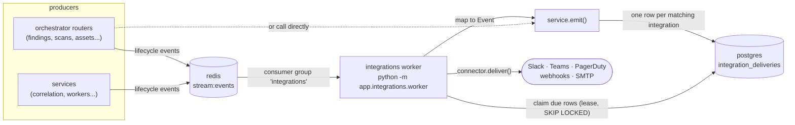

# Integrations

Paddock pushes what it finds into the tools your team already watches: chat,
paging, email, and anything that accepts a signed webhook. Every integration is
a plugin behind one interface and is managed on a single page, **Govern →
Integrations**, where you connect it, test it, pick what it hears about, and see
every delivery it made.

* [Architecture](#architecture)
* [Event catalogue](#event-catalogue)
* [Choosing what an integration receives](#choosing-what-an-integration-receives)
* [Delivery, retries and the dead-letter state](#delivery-retries-and-the-dead-letter-state)
* [Security model](#security-model)
* Connectors: [Webhook](#webhook) · [Slack](#slack) · [Microsoft Teams](#microsoft-teams) · [PagerDuty](#pagerduty) · [Email](#email)
* [REST API](#rest-api)
* [Writing a connector](#writing-a-connector)

---

## Architecture



1. **Producers** publish lifecycle events (`finding_opened`, `finding_closed`,
   `chain_detected`, `attack_path_found`, `asset_added`, `scan_completed`,
   `scan_failed`) to the existing `stream:events`. Code inside the orchestrator
   can skip the stream and call the fan-out directly:

   ```python
   from app.integrations import Event
   from app.integrations.service import emit

   await emit(pool, Event(type="finding.opened", title="...", severity="high", data={...}))
   ```

   `emit` writes one `integration_deliveries` row per enabled integration that
   matches the event. It is idempotent on `(integration_id, event.id)` and never
   raises: a notification problem must not fail the operation that caused it.
2. The **integrations worker** (compose service `integrations`, same image as
   the orchestrator) reads `stream:events` as consumer group `integrations`,
   maps each entry to a normalized `Event` (enriched from the database: title,
   asset, owner, tags), calls the fan-out, and acknowledges the entry. If the
   database is down the entry stays pending and is re-read; because event ids
   are derived from the underlying fact (e.g. `finding.opened:<finding id>`),
   re-processing and duplicate publishers never produce duplicate deliveries.
3. The same worker runs the **delivery loop**: every 2 s it claims due rows,
   calls the connector, and records the outcome. Several replicas can run
   side by side (rows are leased with `FOR UPDATE SKIP LOCKED`).

The **Test** button is the one synchronous path: the API sends an
`integration.test` event straight through the connector and returns the result.

## Event catalogue

| Type | When | Severity | Typical `data` keys |
|---|---|---|---|
| `finding.opened` | a new finding (or correlated chain) was opened | finding's | `finding_id` (`chain_id` for chains), `asset`, `asset_kind`, `rule_id`, `rule_source`, `owner`, `tags`, `cvss`, `epss` |
| `finding.updated` | severity / status / owner changed | finding's | as above |
| `finding.resolved` | fixed or verified closed | finding's | as above + `status` |
| `finding.reopened` | a fixed finding came back | finding's | as above |
| `finding.accepted` | risk-accepted, false positive or won't-fix | finding's | as above + `status` |
| `attack_path.opened` | a new path to a crown jewel | path's | `attack_path_id`, `fingerprint`, `source_asset`, `target_asset`, `exploitability`, `kev_on_path` |
| `change.detected` | the attack surface changed | change's | `change_type`, `asset` |
| `asset.discovered` | a new asset | none | `asset_id`, `asset`, `asset_kind`, `source` |
| `device.behavior` | a Sentry behaviour detector fired | detector's | `device`, `detector` |
| `scan.completed` / `scan.failed` | a scan finished / failed | none | `scan_id`, `scan_kind`, `target`, `error` |
| `report.digest` | the scheduled digest is ready | none | |
| `integration.test` | the Test button | `info` | `integration_id`, `integration_name` |

Every event serializes to the same envelope (this is exactly the webhook body):

```json
{
  "id": "1b0e5c84-7d0c-5f4e-8a55-5d2a9a2c1f10",
  "type": "finding.opened",
  "occurred_at": "2026-11-21T09:14:03.120000+00:00",
  "severity": "critical",
  "title": ".env file exposed",
  "summary": "Database credentials are public.",
  "url": "https://paddock.example.com/findings?focus=6f1c...",
  "tenant_id": null,
  "data": {"finding_id": "6f1c...", "asset": "pay.example.com", "asset_kind": "subdomain", "...": "..."}
}
```

`url` deep-links into the dashboard; set `PADDOCK_DASHBOARD_URL` to your public
dashboard address.

## Choosing what an integration receives

All three are AND-ed:

* **Events**: the event types it subscribes to (checkboxes on the page).
* **Minimum severity**: drops events below it. Only events that *carry* a
  severity are gated; `asset.discovered` and `scan.*` are controlled by the
  subscription alone.
* **Filters** (optional). Each one narrows; an event that lacks the filtered
  attribute does **not** match.

  | Filter | Matches `data.` | Example |
  |---|---|---|
  | `asset_kinds` | `asset_kind` | `["domain", "subdomain"]` |
  | `rule_sources` | `rule_source` | `["cve_match", "nuclei"]` |
  | `owners` | `owner` | `["payments-team"]` |
  | `tags` | any of the asset's `metadata.tags` | `["prod", "pci"]` |
  | `assets` | `asset`, shell-style globs | `["*.prod.example.com"]` |

## Delivery, retries and the dead-letter state

| Status | Meaning |
|---|---|
| `pending` | queued, due at `next_attempt_at` |
| `sent` | the remote accepted it (2xx / SMTP 250) |
| `failed` | the attempt failed; if `next_attempt_at` is set it will be retried then |
| `dead` | permanent failure, or retries exhausted. Fix the cause, then press **Retry** |
| `skipped` | the integration was disabled before the row was delivered |

* Retryable: timeouts, connection errors, HTTP 408/409/425/429 and 5xx, SMTP 4xx.
  Not retryable: other 4xx (bad key, dead Slack hook), redirects, URLs refused
  by the outbound policy, SMTP auth failures, a server without STARTTLS.
* Backoff: `30s · 2^(attempt-1)`, capped at 1 h, ±10% jitter; dead after 8
  attempts (about an hour of trying). Tunable via `INTEGRATIONS_MAX_ATTEMPTS`,
  `INTEGRATIONS_BACKOFF_BASE_SEC`, `INTEGRATIONS_BACKOFF_MAX_SEC`.
* `integrations.last_ok_at` / `last_error` / `last_error_at` drive the status
  dot on each card; `GET /v1/integrations/health` summarizes everything and
  flags a **stalled** queue (due work older than 10 minutes means the worker is
  not running).

Worker environment: `DATABASE_URL`, `REDIS_URL`, `PADDOCK_SECRET_KEY`
(+`_OLD`), `PADDOCK_DASHBOARD_URL`, and optionally `INTEGRATIONS_POLL_SEC` (2),
`INTEGRATIONS_BATCH` (20), `INTEGRATIONS_LEASE_SEC` (300),
`INTEGRATIONS_HTTP_TIMEOUT_SEC` (10), `INTEGRATIONS_CONSUMER_GROUP`
(`integrations`), `INTEGRATIONS_CONSUMER_NAME` (hostname).

## Security model

* **Credentials are write-only.** Secret fields (webhook URLs that embed a
  token, routing keys, SMTP passwords, signing secrets) are encrypted with
  AES-256-GCM before they reach the database (`PADDOCK_SECRET_KEY`), returned
  by the API only as `********`, decrypted only in the worker's memory for the
  duration of a batch, and never logged or written to `detail`. In the
  hardened profile (`AUTH_MODE=enforce`) the API refuses to store a secret
  until `PADDOCK_SECRET_KEY` is set. To rotate, move the old key to
  `PADDOCK_SECRET_KEY_OLD` and set a new primary.
* **No SSRF.** Every outbound request goes through a client that validates the
  URL on every send (https only, every resolved address checked, cloud metadata
  and reserved ranges always refused, private/LAN addresses only when the
  integration has **Allow private network** switched on) and never follows
  redirects. SMTP hosts get the same check. URLs are also validated when you
  save, so mistakes surface in the form.
* **Admin only.** Creating, editing, testing, enabling/disabling and retrying
  need the `admin` capability; reading needs `read`. Every write lands in the
  hash-chained audit log (request bodies, and therefore secrets, are not
  recorded).
* Email is always encrypted (STARTTLS or implicit TLS, certificate verified);
  there is no plaintext mode.

---

## Webhook

Generic HTTPS POST of the event envelope above, signed so you can prove it came
from Paddock.

**Setup:** *Integrations → Webhook → Configure*: endpoint URL + a signing
secret (generate one: `openssl rand -hex 32`). Subscribe to events, press
**Test**.

**Headers on every request:**

| Header | Value |
|---|---|
| `Content-Type` | `application/json` |
| `Paddock-Event` | the event type, e.g. `finding.opened` |
| `Paddock-Delivery` | the event id. Stable across retries: de-duplicate on it |
| `Paddock-Signature` | `t=<unix seconds>,v1=<hex HMAC-SHA256(secret, "<t>.<raw body>")>` |

**Verifying.** Use the *raw* request bytes (not re-serialized JSON), compare in
constant time, and reject timestamps more than **5 minutes** from now (replay
protection). Answer 2xx quickly; anything else is retried as described above.

Python:

```python
import hashlib, hmac, time

def verify(secret: str, raw_body: bytes, header: str, tolerance: int = 300) -> bool:
    parts = dict(p.split("=", 1) for p in header.split(",") if "=" in p)
    try:
        t = int(parts["t"])
    except (KeyError, ValueError):
        return False
    if abs(time.time() - t) > tolerance:
        return False                                   # outside the replay window
    expected = hmac.new(secret.encode(), f"{t}.".encode() + raw_body, hashlib.sha256).hexdigest()
    return hmac.compare_digest(expected, parts.get("v1", ""))

# Flask:  verify(SECRET, request.get_data(), request.headers["Paddock-Signature"])
```

Node.js (18+):

```js
import crypto from "node:crypto";

export function verify(secret, rawBody /* Buffer */, header, toleranceSec = 300) {
  const parts = Object.fromEntries(header.split(",").map((p) => p.split("=", 2)));
  const t = Number.parseInt(parts.t, 10);
  if (!Number.isFinite(t) || Math.abs(Date.now() / 1000 - t) > toleranceSec) return false;
  const expected = crypto.createHmac("sha256", secret).update(`${t}.`).update(rawBody).digest("hex");
  const given = Buffer.from(parts.v1 ?? "", "utf8");
  const want = Buffer.from(expected, "utf8");
  return given.length === want.length && crypto.timingSafeEqual(given, want);
}

// Express: app.post("/paddock", express.raw({ type: "application/json" }), (req, res) => {
//   if (!verify(process.env.PADDOCK_SECRET, req.body, req.get("Paddock-Signature"))) return res.sendStatus(401);
//   res.sendStatus(204);
// });
```

Known vector: secret `secret`, body `{}`, `t=1700000000` →
`v1 = HMAC_SHA256("secret", "1700000000.{}")`.

## Slack

Posts a Block Kit message: title, severity, asset, event type, owner, a "why it
matters" line and an **Open in Paddock** button.

1. Go to <https://api.slack.com/apps> → **Create New App** → *From scratch*.
2. **Incoming Webhooks** → toggle on → **Add New Webhook to Workspace** →
   choose the channel → copy the URL (`https://hooks.slack.com/services/...`).
3. In Paddock: *Slack → Configure*, paste it into **Webhook URL** (stored
   encrypted; the URL is the credential). Optionally set **Mention on
   high/critical** (`<!here>`, `<!channel>` or `<@U012AB3CD>`).
4. Pick events (suggested: `finding.opened`, `attack_path.opened`) and a
   minimum severity of `high`, then **Test**.

A revoked hook (`404 no_service`, `410`) is dead-lettered immediately.

## Microsoft Teams

Posts an Adaptive Card (v1.4) through a Teams **Workflows** webhook (the old
Office 365 connectors are retired).

1. In the target channel: **⋯ → Workflows** → template **"Post to a channel
   when a webhook request is received"** → choose team/channel → **Add
   workflow** → copy the URL it shows.
2. In Paddock: *Microsoft Teams → Configure*, paste it into **Webhook URL**
   (stored encrypted: it contains a `sig=` signature).
3. Choose events and severity, **Test**. Workflows answer `202 Accepted`; the
   card appears a few seconds later.

## PagerDuty

Uses the Events API v2 (`/v2/enqueue`).

* `dedup_key` = the finding id (or `chain:<id>`, `fingerprint:<fp>`,
  `scan:<id>`), so re-deliveries and updates fold into one incident.
* `finding.resolved` and `finding.accepted` send `event_action: resolve` for
  that key; other events trigger. Severity maps critical→critical,
  high→error, medium→warning, low/info→info.
* **Test** triggers an `info` alert with a throwaway key and resolves it at
  once, so it never leaves an open incident.

Setup: PagerDuty → **Services** → your service → **Integrations** → **Add an
integration** → **Events API V2** → copy the **Integration Key** into
**Routing key**. Choose **Service region** `eu` if your account lives in the
EU data center. Suggested subscription: `finding.opened`, `finding.resolved`,
`finding.accepted`, `attack_path.opened` at `critical`.

## Email

SMTP with STARTTLS (port 587, default) or implicit TLS (465); certificates are
verified and there is no plaintext mode. Each message is multipart text + HTML
with a `Message-ID` derived from the event id.

Config: **SMTP host**, **Port**, **Encryption**, **From address**,
**Recipients** (up to 50), **Subject prefix**. Secrets: **username** and
**password** (optional for relays that don't authenticate).

| Provider | Host | Notes |
|---|---|---|
| Amazon SES | `email-smtp.<region>.amazonaws.com` | SMTP credentials from the SES console; verified sender |
| SendGrid | `smtp.sendgrid.net` | username `apikey`, password = API key |
| Microsoft 365 | `smtp.office365.com` | SMTP AUTH must be enabled for the mailbox |
| Google Workspace | `smtp.gmail.com` | app password, or use the SMTP relay service |
| LAN relay | e.g. `mail.corp.internal` | switch on **Allow private network** |

**Test** (health mode) performs the handshake (EHLO → STARTTLS → login → NOOP)
without sending; the **Send test** button sends a real test email.

---

## REST API

All under `/v1/integrations`. Reads need `read`; writes need `admin`.

| Method & path | |
|---|---|
| `GET /catalog` | registered connectors (`kind`, `display_name`, `category`, `capabilities`, `config_schema`, `secret_fields`, `required_secrets`, `docs_url`), the event catalogue, severities, filter keys |
| `GET /health` | `status` (`ok`/`degraded`/`empty`), per-status counts, queue depth, `stalled`, `secret_key_persistent`, per-integration status |
| `GET /` | list (secrets redacted, with per-integration delivery stats) |
| `POST /` | create: `{kind, name, config, secrets, events, min_severity, filters, allow_private, enabled}` |
| `GET /{id}` | one integration |
| `PATCH /{id}` | partial update. `secrets`: a value sets, `""`/`null` clears, `"********"` keeps |
| `DELETE /{id}` | delete (its deliveries go with it) |
| `POST /{id}/enable`, `POST /{id}/disable` | toggle |
| `POST /{id}/test` | body `{"mode": "deliver"}` (default: send an `integration.test` event, logged) or `{"mode": "health"}` (run the connector's `test()`) → `{ok, status_code, detail, retryable, delivery_id, ...}` |
| `GET /{id}/deliveries?status=&limit=&offset=` | delivery log, newest first |
| `POST /{id}/deliveries/{delivery_id}/retry` | re-queue a failed/dead/skipped/sent delivery |

Validation errors return `422 {"detail": {"message": ..., "errors": ["config.url: is required", ...]}}`.

## Writing a connector

1. Add `orchestrator/app/integrations/connectors/<name>.py` with a
   `@register`-ed subclass of `Connector` (see `base.py` for the rules: never
   echo secrets, use `self.http`, be idempotent on `event.id`, map remote
   failures to `DeliveryResult(ok=False, retryable=...)`).
2. Declare `config_schema` (the subset in `configschema.py` is validated on
   save and rendered as the form) and `secret_fields`. Two optional class
   attributes are honoured by the API: `required_secrets` (must be set on save)
   and `url_fields` (config/secret fields that are outbound URLs, checked
   against the outbound policy on save).
3. Use `app.integrations.outbound.post(self.http, url, json_body=...,
   secrets=self.secrets.values())` to get correct status/exception mapping with
   secret scrubbing for free.
4. Add the module name to `_MODULES` in `connectors/__init__.py`, implement a
   real `test()`, and write tests with `httpx.MockTransport` (see
   `orchestrator/tests/test_integrations_core.py`). Never call a real service
   from tests.
