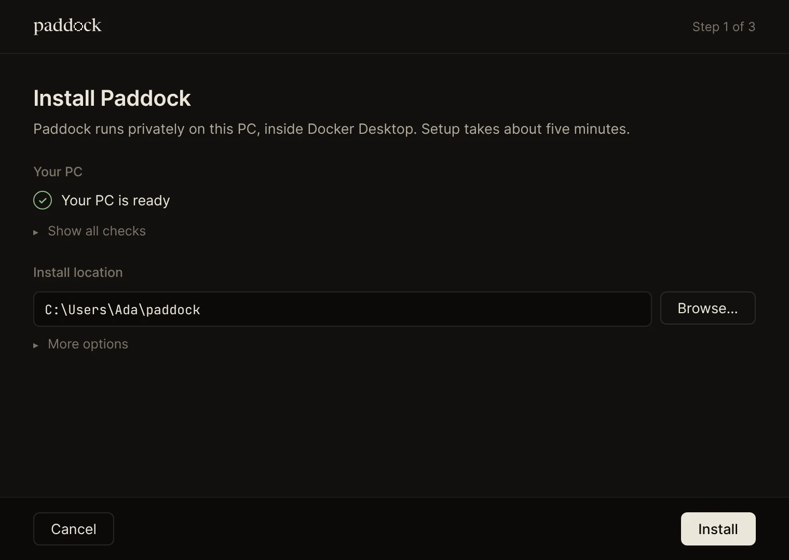
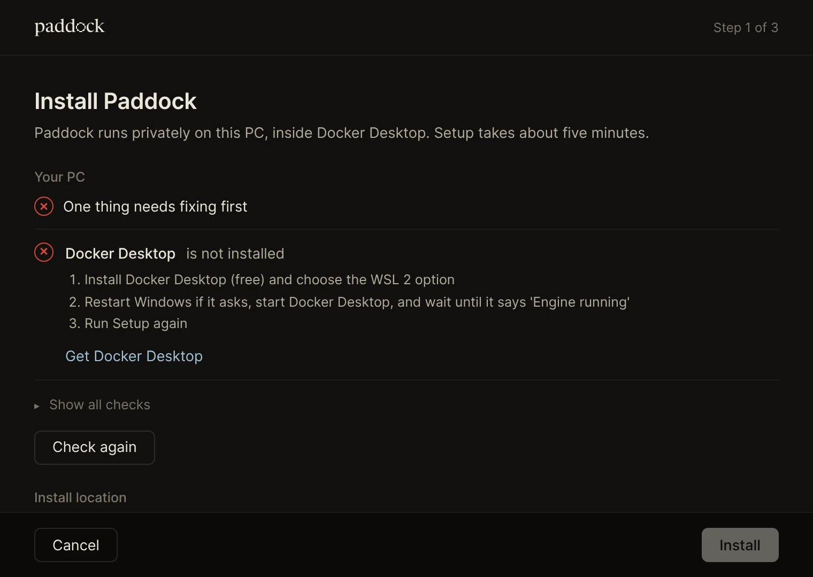
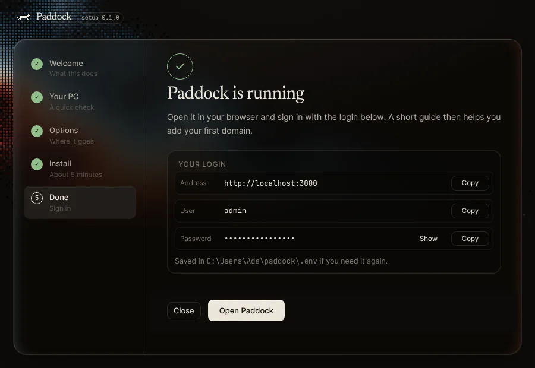

# Paddock Setup

The Windows installer: **one `Paddock-Setup.exe`**, double-click, a few friendly screens,
and Paddock is running. It is a graphical front end for [`scripts/install.ps1`](../scripts/install.ps1),
so the checks, the secrets and the install itself are the same code the command line uses.





*(From the demo mode described below, with scripted data.)*

## What the user sees

Three screens, in a flat window with a fixed button bar:

1. **Install Paddock.** The PC check starts by itself the moment the window opens, so there is
   nothing to click through. If everything passes it is one line ("Your PC is ready", with the
   full list one click away) beside the install folder and an Install button. If something
   blocks, only that is shown: what is wrong, numbered steps to fix it, and a download link where
   one helps. Install stays disabled until it is fixed. The install location has a **Browse**
   button (the native folder dialog), and *More options* holds a Start menu shortcut (on by
   default) and the optional active scanner.
2. **Installing.** One status line, one progress bar with a percentage; the raw output is under
   Details.
3. **Done.** Address, user and password (hidden until Show, with Copy) and Open Paddock.

If Paddock is already installed the wizard opens on a manage screen instead: Open or Start,
Update or repair, Stop, and Remove (with a confirmation). Failures lead with one plain sentence
about what happened and what to do; the tool output is under Technical details and in Copy
details. **Get help** opens a pre-filled GitHub issue containing only the headline: the technical
details can name folders or machines, so the person pastes them in themselves.

A successful install also leaves a **Paddock** entry in the Start menu (a plain `.url` file that
opens the dashboard; `-NoShortcut` skips it, and a full remove deletes it).

The script speaks to a console (lowercase log lines, raw megabytes), so `ui/src/humanize.ts`
translates what it says into what a person should read (16 GB, "Downloading Paddock (about
1.5 GB)", "Setup could not download Paddock."). The raw text is never thrown away.

## How it is put together

```
installer/
  core/        Rust, no dependencies. Decides what may run: validates the install folder,
               builds the PowerShell argument list, allow-lists the pages that may be opened,
               detects an existing install. `cargo test` runs anywhere.
  ui/          React + TypeScript. The wizard: flat and solid on purpose. Reuses only the
               dashboard's wordmark and colour/type tokens straight from ../dashboard/src
               (nothing copied, nothing restyled). `protocol.ts` turns the script's output
               into screen state; `humanize.ts` turns it into plain English.
  src-tauri/   The Tauri shell. Deliberately thin: unpack the embedded files, start PowerShell,
               forward its output lines, stop it on cancel or close. Depends on core/.
  scripts/prepare_resources.py   gathers install.ps1, the compose file and schema/ for embedding
  resources/   (generated, git-ignored) what build.rs bakes into the .exe
```

The `.exe` carries everything except the Docker images (those are pulled from GHCR, 1-2 minutes).
It needs Windows 10 (1809+) or 11 with the **WebView2 runtime**, which is present on Windows 11
and on almost every up-to-date Windows 10. Without it Windows says so; `install.bat` in the
release zip is the fallback.

### The `install.ps1 -Json` protocol

With `-Json` the script writes **one JSON object per line** to stdout and nothing else:

| `type` | fields | meaning |
|---|---|---|
| `step` | `id`, `text` | a phase began. Ids in order: `checks`, `files`, `secrets`, `images`, `start`, `health` (`remove` for stop/remove) |
| `check` | `name`, `status` (`ok`/`warn`/`fail`), `detail`, `fix` | one PC check; `fix` may span lines |
| `summary` | `fail`, `warn` | end of the checks |
| `log` | `text` | a line of output (the image download, etc.) |
| `warn` | `text` | something to know, not a failure |
| `error` | `text` | the script is about to fail, with the reason |
| `result` | `healthy`, `url`, `username`, `password`, `dir`, `version` | install finished. Printed even when `healthy` is false, and the script then exits 1 on purpose |
| `done` | `action` (`stop`/`remove`) | stop or remove finished |

Anything that is not one of these (a stray PowerShell message) is shown in the details log, never
dropped. The tests that pin this: `ui/tests/protocol.test.ts`, and the `-Json` step in
`.github/workflows/installers.yml`, which runs the real script on real PowerShell.

## Build it

On Windows (needs Node 22, Rust, Python 3):

```powershell
python installer/scripts/prepare_resources.py            # dev build: builds Paddock from source
python installer/scripts/prepare_resources.py --version 1.2.3   # what a release does
npm --prefix installer/ui ci; npm --prefix installer ci
cd installer; npx tauri build --no-bundle                # -> src-tauri/target/release/paddock-setup.exe
```

CI does exactly this (`installer-app.yml` on pull requests, `release.yml` on a version tag, where
the exe is attested and its checksum goes into the signed `BUNDLE_SHA256SUMS.txt`).

## Preview the screens without Windows or Docker

```bash
cd installer/ui && npm ci && npm run demo      # http://localhost:1420
#   ?scenario=fresh | docker-missing | ports | fail | installed | stopped   &speed=0.2
```

The demo bridge is a build-time option (`VITE_DEMO=1`); a real build contains none of it
(`installer-app.yml` greps for that).

## Tests

```bash
(cd installer/core && cargo test)                  # 13: folder validation, args, URL allow-list, detection
(cd installer/ui && npm test)                      # 51: the protocol, the wording, and every screen, with a fake bridge
python3 -m pytest scripts/tests/test_installer_resources.py
```

## What is and is not verified

**Verified in CI and locally:** the Rust core (tests, clippy, fmt); the wizard's logic and screens
(vitest, with a fake bridge) and its visual design (screenshots at the real 900x620 window size);
the shell **compiles against Tauri 2 for Windows** (`cargo check --target x86_64-pc-windows-gnu`);
the `-Json` output on real PowerShell 5.1 and 7 against a fake Docker (`installers.yml`).

**Not verified by a person:** the finished `.exe` has not been run on a real Windows PC with Docker
Desktop. `installer-app.yml` builds it on `windows-latest` and checks that it starts and stays up,
but nothing here starts the real stack. Treat the first run on a clean machine as the real test.

**Known limits:**

* **Not code-signed.** There is no certificate yet, so Windows SmartScreen shows "Windows protected
  your PC" on first run (More info, then Run anyway). Signing needs an Authenticode certificate
  (or Azure Trusted Signing); it is a separate decision. Until then the release lists a SHA-256 and
  a build-provenance attestation ([`docs/trust/VERIFY.md`](../docs/trust/VERIFY.md)).
* **It still needs Docker Desktop.** The wizard checks for it, explains how to install it and
  offers the download page, but it does not install Docker itself (that needs admin rights, a
  restart and acceptance of Docker's licence terms).
* **Closing the window cancels a running install.** The partly pulled images are kept, so running
  Setup again resumes quickly.
